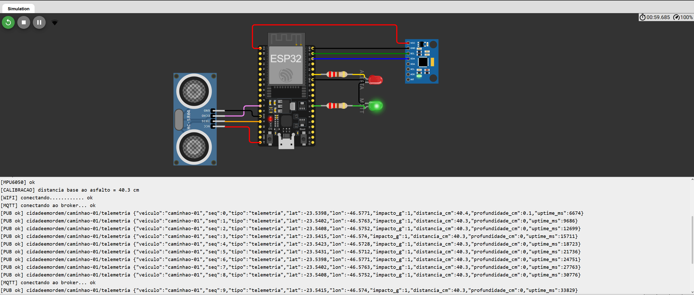
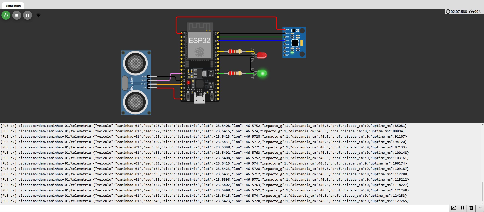
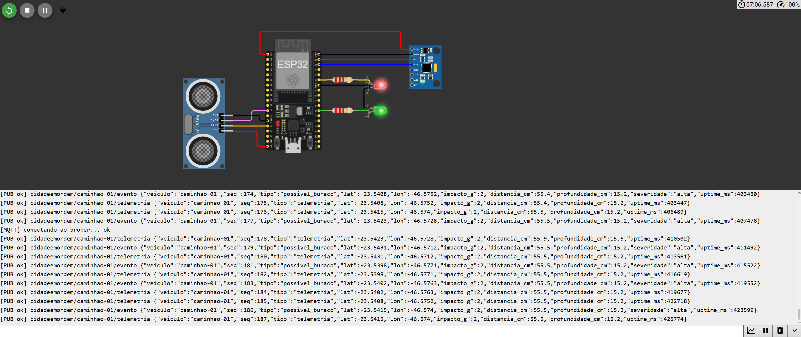
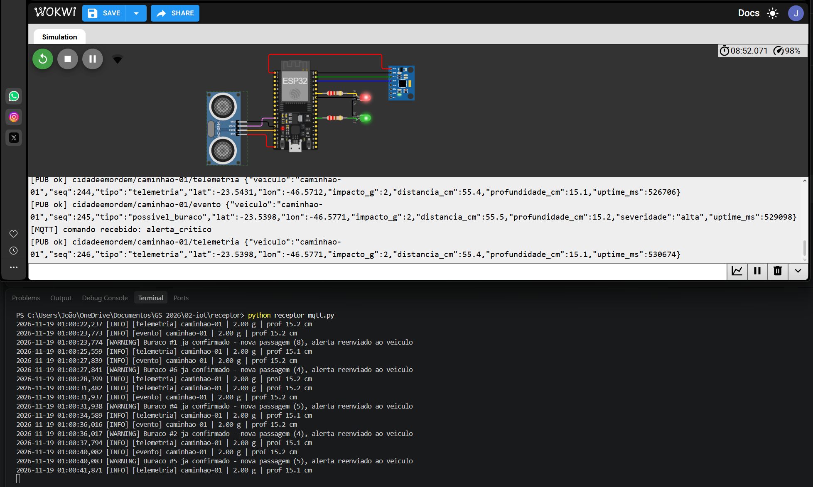

# Cidade em Ordem: Módulo IoT do caminhão de coleta

**Physical Computing, Embedded AI, Robotics & Cognitive IoT** · Global Solution 2026.2 · Tecnólogo em IA – 2TIAPR

| Integrante | RM |
|---|---|
| João Pedro de Souza Nunes | RM567318 |
| Guilherme Nakamura | RM567460 |

---

## 1. Problema, público e relevância

Em 2025, a Prefeitura de São Paulo recebeu **113,1 mil pedidos de tapa-buraco** (177,3 mil em 2023), cerca de
**287 por dia**, e reconhece que um mesmo buraco gera vários chamados. Todo esse fluxo depende de alguém
parar e reclamar. Enquanto isso, buracos causam quedas de motociclistas e ciclistas, danos a veículos e
riscos a pedestres. *(Fonte: Secretaria Municipal das Subprefeituras, via BNews SP, 2025. Ver `docs/dados_do_problema.md`.)*

**Público beneficiado:** motoristas, motociclistas, ciclistas e pedestres, que ganham ruas mais seguras, e a
equipe de manutenção da subprefeitura, que recebe os pontos já confirmados e localizados.

**Ideia:** os caminhões de coleta de lixo já passam por todas as ruas várias vezes por semana. Um ESP32 com
dois sensores instalado no caminhão **sente** o buraco quando passa por ele. Ninguém precisa reclamar.

## 2. Arquitetura da solução

```
 [MPU6050 acelerômetro] ─┐                                   ┌─> SQLite (leituras, buracos, status)
                         ├─> ESP32 ──MQTT──> broker.hivemq ──┤
 [HC-SR04 ultrassônico] ─┘    ▲                              ├─> Receptor Python (validação + regra de confirmação)
                              │                              │      ├─> alerta Telegram (opcional)
        LED vermelho <── comando "alerta_critico" ◄──────────┘      └─> 06-rpa/entrada/deteccoes_iot.json
                                                                           └─> robô RPA abre ordem de serviço
                                                                                └─> Front-end (mapa e status)
```

### Origem dos dados
| Sensor | O que mede | Como vira informação |
|---|---|---|
| **MPU6050** (acelerômetro, I²C em SDA 22 / SCL 23) | Aceleração nos 3 eixos | Calcula o módulo do vetor em g. Parado/rodando liso ≈ 1 g. Variação ≥ 1,5 g = impacto |
| **HC-SR04** (ultrassônico, TRIG 13 / ECHO 14), apontado para o asfalto | Distância até o chão | Calibrado no início (≈ 40 cm). Distância maior que a base = depressão. Profundidade = distância − base |
| GPS (simulado no código) | Posição | Rota fixa no Tatuapé (SP), já que o Wokwi não tem módulo GPS |

### Comunicação MQTT
| Tópico | Direção | Conteúdo | QoS |
|---|---|---|---|
| `cidadeemordem/caminhao-01/telemetria` | ESP32 → central | Leitura periódica a cada 3 s | 0 |
| `cidadeemordem/caminhao-01/evento` | ESP32 → central | Enviado na hora quando os sensores indicam buraco (com severidade) | 0 |
| `cidadeemordem/caminhao-01/status` | ESP32 → central | `online`/`offline`, com mensagem **retida** e **Last Will** (o broker avisa se o ESP32 cair) | 1 |
| `cidadeemordem/caminhao-01/comando` | central → ESP32 | `{"acao":"alerta_critico"}` acende o LED; `{"acao":"limpar"}` apaga | 1 |

Exemplo de mensagem de evento:
```json
{"veiculo":"caminhao-01","seq":4,"tipo":"possivel_buraco","lat":-23.5431,"lon":-46.5712,
 "impacto_g":3.4,"distancia_cm":53.0,"profundidade_cm":13.0,"severidade":"alta","uptime_ms":12000}
```

### Processamento (Edge + central)
- **No ESP32 (borda):** o evento só é enviado quando há impacto ≥ 1,5 g ou profundidade ≥ 4 cm, com intervalo
  mínimo de 4 s para não repetir o mesmo buraco. Leituras inválidas do ultrassônico (timeout) são descartadas.
- **Na central:** valida campos e faixas, grava tudo no SQLite e agrupa eventos a menos de 25 m (fórmula de
  Haversine) como o **mesmo buraco**. O buraco é **confirmado** quando a severidade é alta ou quando duas
  passagens diferentes o detectam. Isso reduz falsos positivos, como uma lombada ou uma tampa de bueiro.
  A cada nova passagem por um buraco já confirmado, a central reenvia o alerta ao motorista, sem duplicar
  a ordem de serviço nem o aviso no Telegram.

## 3. Evidências de funcionamento

Testes executados em 18/11/2026 com o broker público `broker.hivemq.com`. Log completo em
`evidencias/log_receptor_teste.txt` e banco em `evidencias/conteudo_banco_teste.txt`.

| # | Situação de entrada | Mensagem | Efeito observado na solução |
|---|---|---|---|
| 1 | Rua em bom estado (1,01 g; 0,1 cm) | telemetria | Gravada no banco, nenhum alerta |
| 2 | Buraco moderado (2,2 g; 6 cm) | evento "moderada" | Buraco #1 criado como **suspeito** |
| 3 | Mesmo ponto, 2ª passagem (2,4 g; 6,5 cm) | evento "moderada" | Reconhecido como o mesmo buraco (a menos de 25 m), **confirmado**, comando `alerta_critico` enviado ao ESP32 |
| 4 | Buraco severo (3,4 g; 13 cm) | evento "alta" | Buraco #2 **confirmado na hora**, alerta e exportação para o robô RPA |
| 5 | Mensagem corrompida | texto inválido | Descartada com registro de erro, receptor continua rodando |
| 6 | Leitura fora da faixa do sensor (99 g) | telemetria | Rejeitada pela validação |

Resultado no banco: 4 leituras válidas, 2 buracos confirmados, status do veículo `online`.

### Simulação no Wokwi (19/11/2026)
O mesmo fluxo foi repetido com o ESP32 simulado no Wokwi, movendo os sliders do MPU6050 (aceleração Z) e do
HC-SR04 (distância), com o receptor rodando no computador e ligado ao mesmo broker.



*Figura 1: circuito no Wokwi. O Serial Monitor mostra o MPU6050 encontrado, a calibração do ultrassônico (40,3 cm),
a conexão ao Wi-Fi e ao broker. O LED verde indica MQTT conectado.*



*Figura 2: situação 1 (rua em bom estado). Leituras de 1 g e profundidade 0 cm: só telemetria a cada 3 s, nenhum
evento e o LED vermelho apagado.*



*Figura 3: situação 4 (buraco severo). Com a distância em 55,5 cm (15,2 cm abaixo do asfalto), o ESP32 publica
eventos "possivel_buraco" com severidade **alta**, e o LED vermelho acende. A linha "[MQTT] conectando ao broker... ok"
mostra a reconexão automática quando o broker público derruba a conexão.*



*Figura 4: ciclo completo. Em cima, o ESP32 publica o evento e recebe "[MQTT] comando recebido: alerta_critico".
Embaixo, o receptor registra cada evento, reconhece o buraco já confirmado (a menos de 25 m) e reenvia o alerta ao
veículo.*

## 4. O que foi implementado e o que foi simulado

| Item | Situação |
|---|---|
| ESP32, MPU6050, HC-SR04 e LEDs | Simulados no Wokwi (código real de Arduino, roda igual em placa física) |
| GPS | Simulado por rota fixa no código |
| MQTT, receptor, banco SQLite, regra de confirmação, comando de volta | Implementados e testados com broker real |
| Alerta Telegram | Implementado; ativa com `TELEGRAM_TOKEN` e `TELEGRAM_CHAT_ID` no `.env` |
| `simulador_esp32.py` | Publica as mesmas mensagens do ESP32 para testes repetíveis |

### Limitações
- O broker público não tem autenticação nem TLS. Em produção, seria usado um broker próprio com usuário,
  senha e porta 8883 (TLS).
- O ultrassônico pode sofrer com vibração e com água no buraco. Por isso a confirmação exige dois sinais ou
  duas passagens.
- Lombadas e valetas geram impacto parecido com buraco. A integração com a **visão computacional** (câmera)
  ajuda a diferenciar.
- Os limiares (1,5 g e 4 cm) foram ajustados para a simulação e precisariam de calibração em campo.

## 5. Inovação
O sensor vai onde a cidade **já passa**: o caminhão de coleta. Não exige que o cidadão reclame, não exige
viatura extra e cobre bairros que reclamam pouco. A central devolve um comando ao veículo, o que fecha o
ciclo em tempo real.

## 6. Relação com os ODS
- **ODS 11 (meta 11.2):** vias mais seguras para todos.
- **ODS 9 (meta 9.1):** infraestrutura de qualidade mantida com apoio de tecnologia de baixo custo.
- **ODS 10:** todas as ruas são monitoradas igualmente, não só as dos bairros que mais reclamam.

## 7. Código e como executar
- `esp32-wokwi/sketch.ino`, `diagram.json`, `libraries.txt`: projeto Wokwi. Em https://wokwi.com, crie um
  projeto ESP32, cole os três arquivos e clique em ▶.
- `receptor/receptor_mqtt.py`: central. Rode `pip install -r requirements.txt` e depois `python receptor_mqtt.py`.
- `receptor/simulador_esp32.py`: testes automáticos. Rode `python simulador_esp32.py` com o receptor ligado.
- `receptor/consultar_banco.py`: mostra o conteúdo do banco.
