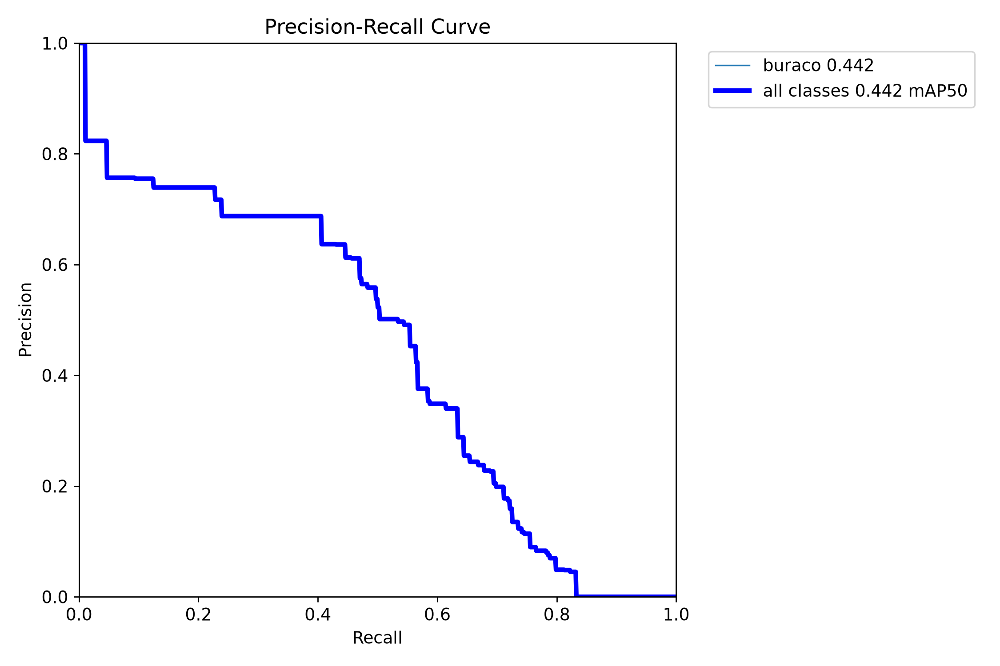
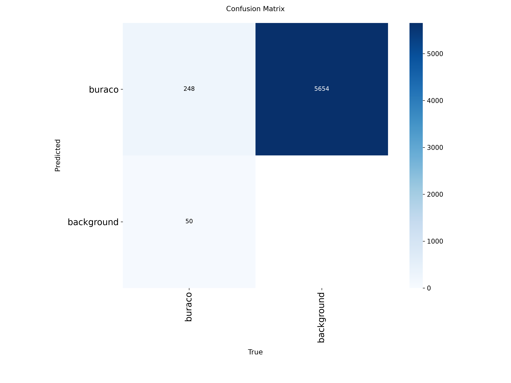
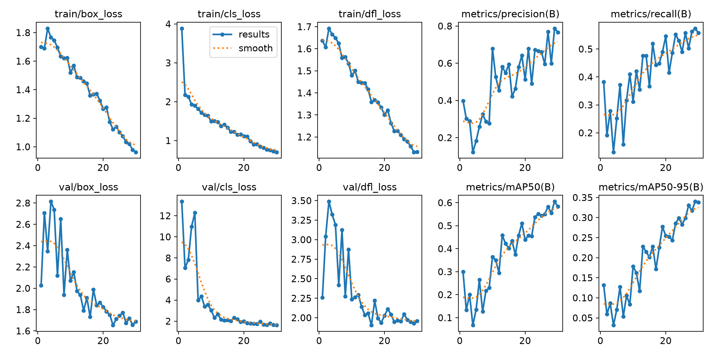
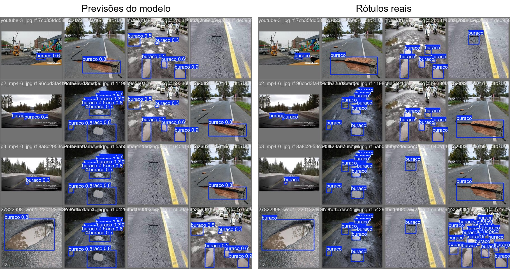

# Detecção de buracos com YOLO11n no Cidade em Ordem

**Visão Computacional** · Global Solution 2026.2 · CitizenTech

| Integrante | RM |
|---|---|
| João Pedro de Souza Nunes | RM567318 |
| Guilherme Nakamura | RM567460 |

## 1. Nicho e objetivo
**Nicho:** 1. Infraestrutura e Pavimentação, com a **detecção de buracos na via** por caixas delimitadoras.

No Cidade em Ordem, uma câmera no caminhão de coleta de lixo, que já passa por todas as ruas, filma o trajeto. O
modelo localiza buracos em cada quadro e informa a confiança. As detecções seguem para o robô RPA, que junta as
repetidas, cruza com o sensor de impacto do mesmo caminhão (módulo IoT) e abre a ordem de serviço. A detecção
**apoia a triagem e a rota de inspeção**. Ela não substitui a vistoria presencial.

## 2. Dados
**Base pública:** Road Damage / Pothole Segmentation (Roboflow Universe, CC BY 4.0, espelhada no Hugging Face em
`manot/pothole-segmentation`), com 819 imagens anotadas em COCO. Os 4 rótulos da base ("potholes", "pothole",
"potholes" e 1 "object") foram unificados na classe única **buraco**, e as caixas foram convertidas para o formato YOLO.

**Divisão sem vazamento.** Ao inspecionar os nomes dos arquivos, vimos que as **819 imagens vêm de apenas 269 fotos
originais**: o Roboflow gera cerca de 3 variações de cada foto (`images44_jpg.rf.<hash>.jpg`). Dividir por imagem
colocaria variações da mesma foto no treino e no teste, e as métricas sairiam infladas. Agrupamos pela foto de
origem e dividimos os **grupos** em 70/15/15. Uma verificação automática confirma que nenhuma foto aparece em dois
conjuntos.

| Conjunto | Imagens | Buracos | Buracos por imagem | Área mediana da caixa |
|---|---|---|---|---|
| Treino | 574 | 1.633 | 2,84 | 1,6% da imagem |
| Validação | 116 | 183 | 1,58 | 4,9% da imagem |
| Teste | 129 | 298 | 2,31 | 1,9% da imagem |

**Pré-processamento:** redimensionamento para 640×640 com *letterbox* (mantém a proporção) e normalização dos pixels
para 0–1. No treino, augmentação padrão do YOLO: variação de brilho, saturação e matiz (HSV), espelhamento
horizontal, mosaico e escala, que simulam variações de iluminação e enquadramento. Validação e teste não recebem
augmentação.

## 3. Arquitetura e treinamento
**YOLO11n** (2,6 milhões de parâmetros, 6,4 GFLOPs), com **transferência de aprendizado** a partir dos pesos
pré-treinados no COCO. Foram transferidas 493 de 499 camadas, e só a cabeça de detecção foi ajustada para 1 classe.

**Por que essa escolha:** é um detector de um estágio, rápido o bastante para vídeo num computador embarcado barato
dentro do caminhão. Os pesos do COCO já reconhecem bordas e texturas, o que permite treinar bem com poucas centenas
de imagens. Modelos maiores (YOLO11s/m) tendem a ganhar alguns pontos de mAP, mas ficam 2 a 4 vezes mais lentos.

**Treino:** 30 épocas, lote 16, otimizador AdamW automático, *early stopping* com paciência 10, semente 42. O
treino foi feito em CPU (AMD Ryzen 9 5900XT, 16 núcleos) e levou cerca de 1 hora. O notebook também roda em GPU no
Colab. Melhor resultado na validação: **mAP@0,5 = 0,605**, precisão 0,786, recall 0,574.

## 4. Resultados no conjunto de teste (nunca visto no treino)

| Métrica | Valor |
|---|---|
| Precisão | **0,611** |
| Recall | **0,456** |
| F1 | **0,523** |
| mAP@0,5 | **0,442** |
| mAP@0,5:0,95 | **0,221** |

*Figura 1: curva precisão × recall no conjunto de teste (mAP@0,5 = 0,442).*

*Figura 2: matriz de confusão no teste. A linha "background" mostra os falsos positivos, e a coluna "background"
os buracos não detectados.*

*Figura 3: perdas e métricas ao longo das 30 épocas de treino. As perdas de validação continuam caindo até o fim
e o mAP@0,5 ainda subia na última época, então não há sobreajuste e mais épocas (em GPU) devem melhorar o modelo.*

### Escolha do limiar de confiança
Rodamos o modelo no teste e calculamos precisão, recall e F1 para cada limiar (acerto = IoU ≥ 0,5):

| Limiar | Precisão | Recall | F1 | Acertos | Falsos positivos | Não detectados |
|---|---|---|---|---|---|---|
| 0,10 | 0,404 | 0,564 | 0,471 | 168 | 248 | 130 |
| 0,20 | 0,483 | 0,517 | 0,499 | 154 | 165 | 144 |
| **0,30** | **0,555** | **0,507** | **0,530** | **151** | **121** | **147** |
| 0,40 | 0,590 | 0,453 | 0,512 | 135 | 94 | 163 |
| 0,50 | 0,598 | 0,389 | 0,472 | 116 | 78 | 182 |
| 0,75 | 0,702 | 0,285 | 0,406 | 85 | 36 | 213 |

**Limiar adotado: 0,30 (maior F1).** O sistema tem duas defesas contra falso positivo: a confirmação pelo sensor de
impacto do caminhão e a exigência de vários quadros no robô RPA. Por isso podemos aceitar um limiar mais baixo e
favorecer o recall, porque deixar de ver um buraco é pior que mandar um fiscal conferir. Detecções com confiança
abaixo de 0,5 entram como "vistoria", e não como ordem de serviço direta.

## 5. Análise de erros

**Acertos típicos:** buracos grandes e de borda bem definida, com água acumulada ou afundamento visível, saem com
confiança de 0,8 a 0,9.

*Figura 4: imagens do teste, com as previsões do modelo à esquerda e os rótulos reais à direita. Aparecem os acertos
em buracos grandes (0,8 a 0,9) e os erros descritos abaixo: buracos pequenos ao fundo que ficam de fora e o buraco
no asfalto trincado (3ª coluna) que não é detectado.*

**Erros observados:**
1. **Buracos pequenos e distantes.** Numa rua muito danificada com cerca de 20 buracos anotados, o modelo encontrou
   só os 5 maiores e mais próximos. O teste tem buracos menores que a validação (área mediana de 1,9% contra 4,9%),
   o que explica boa parte da queda de 0,605 para 0,442 de mAP@0,5. Em 640 px, um buraco a 30 metros ocupa poucos pixels.
2. **Textura complexa.** Um buraco escuro no meio de **asfalto trincado** não foi detectado: o padrão de fissuras
   confunde as bordas.
3. **Caixa diferente do rótulo.** Num desmoronamento de pista, o modelo marcou só a parte afundada, e o rótulo
   incluía a placa de asfalto levantada. Pelo IoU, isso conta como erro, embora a detecção seja útil.
4. **Ruído nos rótulos.** A mesma foto aparece com anotações diferentes em suas variações: numa versão uma poça
   está marcada como buraco, na outra não. O modelo é penalizado por detectar algo que em outra versão é considerado
   correto.

### Robustez a interferências urbanas (limiar 0,30)
| Condição | Precisão | Recall | Variação do recall |
|---|---|---|---|
| Original | 0,555 | 0,507 | – |
| Sombra (40% de brilho em metade da imagem) | 0,515 | 0,450 | −11% |
| Pouca luz (anoitecer, gama 2,2) | 0,500 | 0,443 | −13% |
| Luz estourada (sol forte) | 0,562 | 0,366 | **−28%** |
| Desfoque (caminhão em movimento) | 0,528 | 0,477 | −6% |
| Obstrução parcial (carro na frente) | 0,296 | 0,225 | **−56%** |

O modelo é **resistente a desfoque e sombra** e **sensível a luz estourada e obstrução**. A obstrução não é um
problema grave na operação: o caminhão passa pela mesma rua várias vezes por semana, então o buraco tapado por um
carro hoje tende a ser visto na próxima passagem. Para luz estourada, a mitigação seria uma câmera com HDR e mais
exemplos com sol forte no treino.

## 6. Desempenho computacional
| Medição | Hardware | Resolução | Latência média | FPS |
|---|---|---|---|---|
| Imagens do teste (pré-processamento + inferência + pós) | CPU AMD Ryzen 9 5900XT (16 núcleos/32 threads), sem GPU | 640×640 | 32,7 ms | 30,5 |
| Vídeo do trajeto (40 quadros, 960×540) | mesma CPU | 640×640 | 26,7 ms | 37,4 do modelo / 30,7 ponta a ponta |

A 30 FPS em CPU, o modelo acompanha uma câmera comum em tempo real. Um caminhão de coleta anda em média a menos de
20 km/h, e a 30 FPS cada metro de rua aparece em vários quadros. Isso dispensaria GPU no veículo: um mini PC ou uma
placa embarcada com acelerador seria suficiente.

## 7. Integração com o CitizenTech
- **Imagem:** `app_visao.py` (Gradio) recebe uma foto e devolve as caixas, a confiança de cada buraco e a recomendação
  (ordem de serviço ou vistoria). A mesma função existe no notebook (`analisar_imagem`).
- **Monitoramento contínuo:** a sequência de imagens de teste foi montada como o vídeo do trajeto do caminhão
  (`resultados/trajeto_simulado.mp4`) e processada quadro a quadro (`resultados/trajeto_anotado.mp4`). Cada detecção
  recebe a posição GPS simulada do caminhão naquele instante.
- **Saída para o robô:** `resultados/deteccoes_visao.json` (64 detecções), copiado para `06-rpa/entrada/`. Na execução
  integrada, o robô juntou as 64 detecções da câmera e 2 do sensor IoT em **5 ocorrências**. **2 foram confirmadas por
  câmera e sensor (prioridade Crítica)** e 3 só pela câmera em vários quadros (prioridade Média).

## 8. Limitações e próximos passos
- As métricas (mAP@0,5 = 0,44 no teste) são suficientes para **triagem com confirmação**, não para decisão automática.
  Daí a regra de exigir câmera e sensor, ou vários quadros.
- A base tem fotos de outros países e ângulos variados. Para São Paulo, seria preciso anotar imagens da própria
  câmera do caminhão, no ângulo e na altura reais.
- Melhorias esperadas: treinar mais épocas em GPU, usar resolução 960–1280 (buracos pequenos), YOLO11s e limpar os
  rótulos inconsistentes.
- **Privacidade:** em produção, rostos e placas devem ser desfocados antes de armazenar qualquer imagem. O sistema só
  precisa guardar a posição e a confiança da detecção.

## 9. Arquivos e execução
- `deteccao_buracos.ipynb`: notebook completo (dados → treino → avaliação → robustez → desempenho → vídeo → Gradio).
  No Colab: *GPU T4 → Executar tudo*.
- `app_visao.py`: demonstração local com o modelo treinado. Rode `pip install -r requirements.txt` e depois
  `python app_visao.py`, e abra http://127.0.0.1:7860.
- `resultados/`: `best.pt` (modelo), `metricas_visao.json`, gráficos, vídeos, `deteccoes_visao.json` e `log_treino.txt`.
- Vídeo de demonstração: https://youtu.be/sp4HV_C52s8
